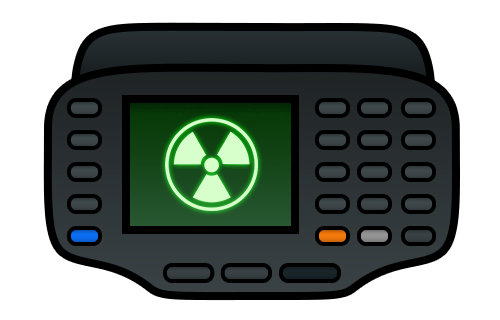
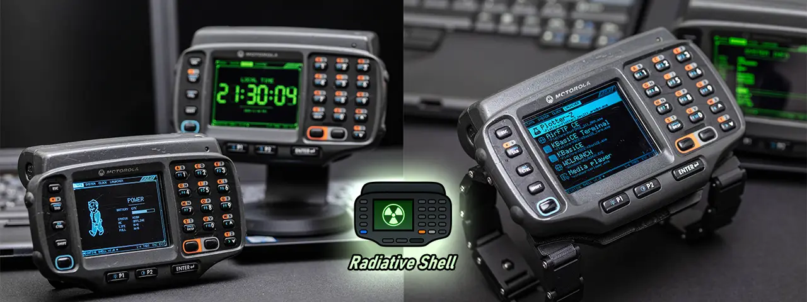

<p align="center">
  
</p>

# Radiative Shell

<p align="center">
  
</p>

A front end for the Motorola WT4090 / WT41N0 series Wrist Mobile Computer,
built to recreate the look of the Pipboy from the *Fallout* games.

It runs on Windows CE and should work on any Handheld PC or Pocket PC with
Windows CE 2.0 or later.

## Installing

- Download a binary from Releases, picking the build that matches the CPU
- Copy `RSHL_hpc211_*.exe` and `RSHL_CFG_hpc211_*.exe` to the device over ActiveSync
- Run `RSHL_hpc211_*.exe`

## Screens

The picture is composed at 320x240 landscape. Everything is drawn into a
frame buffer in four grey levels first, then mapped through the active theme's
VGA palette on its way to the display. The tab strip sits at the top, the
status bar at the bottom, and the current page fills the space between them.

Four pages, cycled with the configured *Tab switch* key, or reached directly
with `1` to `4`:

| Page | Contents |
| --- | --- |
| STATS | Walking figure animation plus a battery report (charge, status, time left) |
| SYSTEM | CPU architecture, page size, memory load bar, uptime, display mode |
| CLOCK | Seven segment clock and the date |
| LAUNCHER | The configured launch slots, each with its type icon |

The status bar shows the program name on the left. When a real `rshl.cfg` was
loaded, the name is followed by a `*`.

## Configuring

Run `RSHL_CFG_hpc211_*.exe` to edit the configuration. It is stored in
`rshl.cfg`, which the shell looks for next to the executable first and then in
the root of the boot volume.

The editor covers three groups:

- **Themes** - three colour schemes, each four VGA palette indexes
  (background, dark, light, primary)
- **Keys** - the virtual key code of six shell commands
- **Slots** - up to nine programs, each with a type icon, a display name and a path

The file format is fixed and parsed by position. Everything from `#` to the end
of a line is a comment, and blank lines are skipped.

```ini
# Theme: three lines, four hexadecimal palette indexes each
10|C0|02|30
10|14|1A|1F
21|22|23|24
# Keys: six lines, one decimal virtual key code each
37
39
38
40
32
13
# Slots: up to nine lines, type|name|path
2|Games|\Storage Card\breakout.exe
8|System|\Application\Net.exe
```

### Keys

The six keys are always read in this order:

| Order | Command | Default |
| --- | --- | --- |
| 1 | Tab switch | `37` (left arrow) |
| 2 | Flip the screen | `39` (right arrow) |
| 3 | Action previous | `38` (up arrow) |
| 4 | Action next | `40` (down arrow) |
| 5 | Theme switch | `32` (space) |
| 6 | Confirm / launch | `13` (return) |

`ESC` always exits and cannot be remapped, so there is still a way out after
both action keys have been reassigned.

### Slot types

`type` runs from 0 to 9 and picks one of ten icons:

| Value | Type | Value | Type |
| --- | --- | --- | --- |
| 0 | Development | 5 | Multimedia |
| 1 | Education | 6 | Office |
| 2 | Games | 7 | Science |
| 3 | Graphics | 8 | System |
| 4 | Internet | 9 | Utilities |

### Default theme

`10|C0|02|30`, the black-on-green Pipboy palette. The three themes can be cycled
at run time with the *Theme switch* key.

> Note that early 2bpp Windows CE displays render in greyscale and never touch
> the palette, so switching themes has no visible effect on those devices.

## Building

The sources live in one place, `frontend/` and `config/`, and both projects
compile the same files.

### Windows CE

Open `sln-ce200/RadiativeShell.dsp` in Visual C++ 6.0 with the CE Toolkit
installed, then pick the configuration for the target CPU (MIPS, SH3, SH4,
ARM, x86 or PPC).

### Win32 desktop, for development

TDM-GCC 10.x (32 bit), `gcc`, `windres` and GNU make are required on `PATH`:

```sh
cd sln-mingw
make          # -> rshell.exe    (release, -O2)
make debug    # -> rshell-d.exe  (debug, -O0 -g)
make run      # build and start it
make clean
```

The desktop build accepts `-o landscape|left|right` so the three flip paths can
be checked without a device.

## Tools

- `tools/rshl-config/` - the configuration editor described above, with desktop and CE projects
- `tools/sprite/` - converts a 24 bit BMP into a packed 2bpp C array. Not currently used: the shipped icons and artwork in `frontend/assets.c` are 1bpp data and are committed directly, so this tool is kept for reference only.

## Roadmap

- Add touch support
- Add Windows CE 1.0 support
